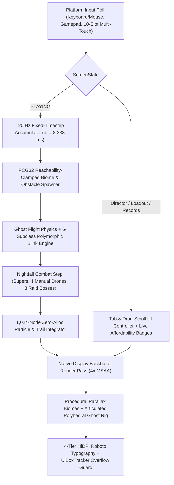
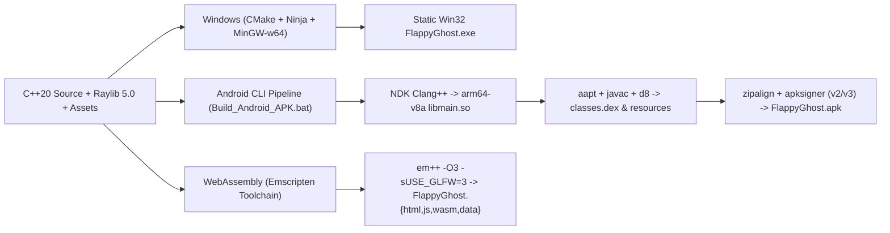

# Destiny: The Flappy Ghost — Engine & Simulation Architecture

> **Technical Case Study** · C++20 · Raylib 5.0 · OpenGL 3.3 / OpenGL ES 2.0 / WebGL 1.0 · Android NDK (`arm64-v8a`) · Emscripten WebAssembly  
> **Live WebAssembly Build:** [sebiny12p.github.io/Portfolio/play/flappy-ghost](https://sebiny12p.github.io/Portfolio/play/flappy-ghost/) · **Releases:** [v1.0 Windows & Android](https://github.com/sebiny12p/Destiny_The_Flappy_Ghost/releases/tag/v1.0)

---

## 1. Architectural Overview & Core Invariants

*Destiny: The Flappy Ghost* is a deterministic, cross-platform C++20 arcade flight and combat engine targeting **Windows (Win32)**, **Android (`arm64-v8a`)**, and **WebAssembly (WebGL)** from a single zero-dependency C++20 source tree (fetching Raylib 5.0 via CMake).

| Subsystem | Engineering Guarantee | Implementation Summary |
| :--- | :--- | :--- |
| **Simulation Tick** | Identical physics & hit detection on `60 Hz`, `120 Hz`, and `240 Hz` monitors | Fixed-timestep accumulator (`FIXED_DT = 1 / 120 s`), max frame delta clamp, and `0.75 s` smooth unpause time-scale ramp |
| **Heap Discipline** | **Zero dynamic allocations** per simulation tick | Static `std::array` object pools (`32` obstacles, `64` motes, `16` enemies, `64` projectiles, `1,024` particles, `180` stars) |
| **Seeded Determinism** | Identical Daily Nightfall obstacle & Mote layouts across CPU architectures | Custom 64-bit state `PCG32` (`XSH-RR`) initialized with a `SplitMix64` hash of `YYYYMMDD` |
| **Procedural Geometry** | Crisp, resolution-independent visuals without sprite-sheet memory bloat | Articulated vector/polyhedral Ghost rig (12 shells × 12 Exotic shaders), boss geometry, and procedural waveform SFX (`SoundSynth`) |
| **Responsive HiDPI UI** | Sharp text & overflow-safe containers across desktop, web & mobile aspect ratios | Native display-resolution backbuffer (`4x MSAA`), aspect-expanded `720p` virtual coordinates, 4-tier `Roboto` font atlases, and `UiBoxTracker` auto-fit clamping |

---

## 2. Engine Loop & State Flow

### Pre-Allocated Static Pool Footprint

All active entities reside inside `GhostGame` in contiguous stack/BSS-friendly `std::array` containers, maximizing L1/L2 cache locality during `120 Hz` sweeps:

| Container | Type | Capacity | Role |
| :--- | :--- | :--- | :--- |
| `obstacles_` | `std::array<Obstacle, 32>` | `32` | Biome pillars, oscillating Vex laser gates, rotating Oracles, and gravitational Taken Blights |
| `collectibles_` | `std::array<Collectible, 64>` | `64` | Magnetized Motes of Light and dodecahedral Exotic Engrams |
| `enemies_` | `std::array<PatrolEnemy, 16>` | `16` | Fallen Shanks, Vex Supplicants, Hive Thralls, and Taken Psions |
| `projectiles_` | `std::array<Projectile, 64>` | `64` | Friendly Super/Drone ordnance (homing, parabolic mortar, shield-stripping, piercing) & Boss patterns |
| `particles_` | `std::array<Particle, 1024>` | `1,024` | Subclass elemental trails, shatter bursts, boss explosions, and thruster plumes |
| `stars_` | `std::array<StarBg, 180>` | `180` | Multi-layer parallax starfield & atmospheric dust |

---

## 3. Deterministic `PCG32` Generation & Passability Guarantees

Naive random gap heights in high-speed flyers occasionally produce impossible vertical transitions—especially when an oscillating Vex gate moves opposite to the next barrier's opening.

### Reachability Envelope Math
`GhostGame::SpawnNextObstacle()` enforces kinematic solvability on every spawned gate:
1. Given horizontal gate spacing $\Delta x$ and current scroll speed $v_x$, the Ghost has flight time $\Delta t = \Delta x / v_x$ between consecutive apertures.
2. Using the Ghost's upward flap impulse and gravitational acceleration $g$, the generator bounds `nextGapY` relative to `lastObstacleGapY_` within asymmetric upward/downward climb envelopes, further tightening the vertical delta whenever either adjacent gate is an oscillating `MOVING_VEX_LASER`.
3. **Mode-Isolated Spawning:** In *Vanguard Patrol*, Oracles, Taken Blight gravity wells, Supers, and Combat Drones are deterministically suppressed so leaderboards test pure flight & Blink mastery, whereas *Nightfall Strike* enables the full combat state machine and `1.5x` Glimmer + Legendary Shard economy.

---

## 4. Polymorphic 6-Subclass Blink State Machine

Rather than duplicating player classes or heap-allocating ability objects (`std::unique_ptr`), all 6 Guardian subclasses drive distinct kinematic regimes inside `UpdatePlayingFixed(float dt)` over shared zero-allocation state scalars:

| Subclass | Kinematic Regime | Mechanical & Collision Rules |
| :--- | :--- | :--- |
| **Voidwalker** | Instantaneous spatial displacement (`+145 px`) | Teleports directly across barrier planes, cancels downward fall velocity into slight lift, and spawns a Void echo |
| **Dawnblade** | `1.15 s` zero-gravity horizontal cruise (`vy = 0`) | Locks altitude for surgical gap threading, grants phase immunity, and expands Mote vacuum radius by `2.25×` |
| **Stormcaller** | High-speed flat Arc bolt dash (`0.26 s`) | Overrides horizontal scroll speed, chain-jolts nearby threats/Oracles, and refunds `35%` cooldown if a gate is cleared mid-surge |
| **Shadebinder** | `3.0 s` global hazard cryo-lock + physical ice rail | Freezes oscillating Vex lasers/Oracles in place and materializes a solid Stasis floor (`+28 px` below) that bounces the Ghost upward |
| **Threadrunner** | Pendulum grapple vector (`0.38 s`) | Fires a Strand anchor ahead-and-above, pulling velocity smoothly along the normalized tether vector with Woven Mail protection |
| **Transcendent** | 2-charge micro-warp (`+90 px`) | Independent 2-charge cooldown bank combining instant forward warp, `1.6 s` local cryo-freeze, and twin homing Prismatic seekers |

---

## 5. Procedural Audio, Vector Rigging & Accessible HiDPI UI

- **Hybrid Procedural + Streaming Audio (`SoundSynth`):** Real-time tactical SFX (flap impulses, elemental Blinks, Mote harmonic chimes, shield breaks, boss telegraphs) are synthesized procedurally into PCM wave buffers at startup (`SoundSynth`), paired with streamed soundtrack playback via Miniaudio.
- **Articulated Polyhedral Ghost Rig:** `RenderGhostRig()` procedurally transforms 8 outer shell fins around a rotating core eye using expand/spin/tilt parameters modulated by velocity, Blink state, and active Exotic Shader (`primary`, `secondary`, `core` palettes).
- **Native Backbuffer + `UiBoxTracker` Accessibility:** Instead of rendering into a blurry `1280×720` intermediate texture and upscaling, the engine renders directly at native physical screen pixels (`GetScreenWidth() × GetScreenHeight()`) with `4x MSAA`. Virtual coordinates lock height to `720.0f` while expanding width dynamically (`virtualWidth_ >= 1280.0f`) on ultrawide `19.5:9` / `20:9` phones. Four `Roboto` font tiers regenerate cleanly whenever display scale or the 3-tier **UI Text Size** accessibility setting (`Normal` / `Large` / `Extra Large`) changes, while `UiBoxTracker` automatically measures and clamps text width to active panel bounds so labels never clip or overflow.

---

## 6. Tri-Platform Standalone Build Pipeline

