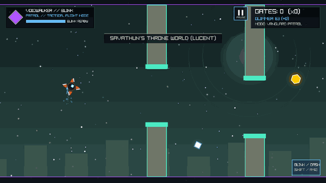

# Destiny: The Flappy Ghost

[](https://github.com/sebiny12p/Destiny_The_Flappy_Ghost/actions/workflows/ci.yml)
[](https://sebiny12p.github.io/Portfolio/play/flappy-ghost/)
[](ARCHITECTURE.md)

A high-performance, cross-platform (Windows & Android) C++20 arcade action game built with **Raylib 5.0**. Pilot an articulated polyhedral Ghost across **8 shuffled Destiny biomes**, harvest Motes of Light, attune across 6 Light, Darkness, and Prismatic subclasses, weave through Vex laser grids, command 4 manual-fire Combat Drones, battle **8 unique Nightfall Raid Bosses**, and collect Exotic Shaders, Catalysts, and Vanguard Triumphs.

> **Studio:** Sebiny Labs  
> **IP Disclaimer:** Non-commercial fan tribute created for educational and portfolio purposes. *Destiny*, *Ghost*, *The Traveler*, and related IP are trademarks and copyright of **Bungie, Inc.**  
> **Play Instantly in Browser:** [**▶ Launch WebAssembly Build (GitHub Pages)**](https://sebiny12p.github.io/Portfolio/play/flappy-ghost/)  
> **Playable Downloads:** [Download Windows `.zip` & Android `.apk` (GitHub Releases)](https://github.com/sebiny12p/Destiny_The_Flappy_Ghost/releases)  
> **Engineering Case Study:** [Read `ARCHITECTURE.md` (120 Hz Loop, PCG32 Envelope Math & NDK/WASM Pipeline)](ARCHITECTURE.md)



---

## Game Modes

*Destiny: The Flappy Ghost* features two distinct flight protocols tailored for both pure aerial precision and full-scale combat:

### 1. Vanguard Patrol (Pure Flight & Precision)
- **Focus:** Skill-based aerial navigation, barrier weaving, and subclass Blink mastery.
- **Rules:** Supers, Combat Drones, and lethal Oracles/Taken Blights are disabled so Patrol high scores strictly reward precision flying and tactical Blink timing.
- **Hostiles:** Enemies appear only as rare scenic encounters.
- **Entry:** Unlocked and playable immediately from the Director.

### 2. Nightfall Strike (High-Intensity Combat & Supers)
- **Focus:** Full-scale combat operations featuring **Super Abilities**, manual-fire Combat Drones, Oracles, Taken Blights, enemy swarms, and Raid Boss encounters.
- **Unlock Condition:** Unlocked once you purchase your first **Combat Drone** from **Loadout -> Drones** (starting at 200 Glimmer).
- **Combat Mechanics:** Charge Super energy from Motes & combat, shatter Boss Overshields with Supers, and fire your Drone with `[C / X]` or the `[DRONE]` button.
- **Rewards:** Earns **+1.5x Glimmer** on Motes of Light plus exclusive **Legendary Shards** (`+1` per 10 Nightfall Gates, `+2` per Exotic Engram, `+5` per Raid Boss, `+3` per Nightfall Triumph) used to unlock Prismatic, Xur's Exotic Catalysts, and pinnacle gear.

---

## Guardian Subclasses (Light, Darkness & Prismatic)

Each subclass features a mechanically distinct **Blink** usable in both modes, plus a dedicated **Nightfall Super**:

| Subclass | Affinity | Subclass Blink Ability | Nightfall Super Ability |
| :--- | :--- | :--- | :--- |
| **Voidwalker** | Void Light | **Astrocyte Blink:** Instant `145px` forward spatial teleport + Void echo | **Nova Bomb:** Massive Void orb shattering shields & clearing 1 hazard |
| **Dawnblade** | Solar Light | **Icarus Hover Jet:** `1.15s` zero-G horizontal Solar cruise + `2.25x` Mote vacuum | **Daybreak:** Twin homing Solar blades on every flap + aura shield |
| **Stormcaller** | Arc Light | **Ionic Surge:** Flat lightning bolt dash, chain-jolts nearby threats & refunds CD on gate | **Chaos Reach:** Aimable Arc laser melting enemies, Oracles & Bosses |
| **Shadebinder** | Stasis Darkness | **Frost Pulse:** `3.0s` hazard freeze + conjures a bounceable Stasis ice rail below | **Winter's Wrath:** Freezes hazards & shatters all foes/shots into Motes |
| **Threadrunner** | Strand Darkness | **Strand Grapple:** Fires an upward grapple anchor ahead to swing & phase | **Needlestorm:** 12+ homing Threadlings hunting foes & Bosses |
| **Transcendent** | Prismatic | **Transcendent Step (2 Charges):** Dual-charge `90px` warp + `1.6s` freeze & seekers | **Transcendence:** 4x Blink recharge + dual Light/Dark bursts |

---

## Loadout, Economy & Persistent Progression (`flappy_ghost_save.dat`)

Open **Loadout** and **Records** from the Director to customize your Ghost and track career milestones using harvested **Glimmer** and Nightfall **Legendary Shards**:

- **12 Procedural Ghost Shells:** Including *Generalist Shell*, *Sagira's Shell*, *Tyrant Warmind*, *Harpy Vex*, *Ghost of the Deep*, and *Flawless Trials*.
- **4 Manual-Fire Combat Drones (Nightfall):**
  1. *Arc Soul Sentinel* — Agile 3-round homing Arc burst.
  2. *Hellion Solar Mortar* — Parabolic arcing 30-dmg Solar AoE artillery clearing nearby foes & shots.
  3. *Briarbinds Void Soul* — Shield-breaker Void seekers that shatter Boss Overshields & vaporize enemy fire.
  4. *NTTE Chronal Portal* — Ultra-fast straight-line piercing precision Chronal rail-beams.
- **12 Exotic Shaders:** Scrollable Tower wardrobe (*Midnight Exigent*, *Calus' Selected*, *Gambit Jadestone*, *Neopop Wave*, *Amethyst Veil*, *Desert Gold*, *Bergusian Night*, *Carminica*, *Cinderchar*, *Butterbark*, *Boreal Defiant*, and *Monochromatic*) with live polyhedral shell preview.
- **Exotic Catalysts & Core Upgrades:** Xur's Exotic Catalysts (*Gjallarhorn Wolfpack*, *Riskrunner Conductor*, *Crimson Redrix*) plus Mote Magnetism, Overshield Capacity, Blink Cooldown, and Super Efficiency upgrades.
- **16 Vanguard Triumphs & Daily Bounties:** Scrollable triumph ledger with real-time progress bars, completion toasts, and rotating daily objectives.
- **Lifetime Career Stats Dossier:** Tracks lifetime gates cleared, Motes harvested, Supers unleashed, Nightfalls conquered, Legendary Shards earned, favorite shell, and favorite subclass.

---

## 8 Shuffled Destiny Biomes & Raid Bosses

Every run shuffles the sector order so each flight starts in a fresh realm and cycles across all 8 Destiny locations:

1. **Cosmodrome Ruins (Fallen):** Rusted Golden-Age steel (`Sepiks Prime` — 3-bolt Void spread fan).
2. **The Vault of Glass (Vex Network):** Teal radiolarian brass & Vex lasers (`The Templar` — rotating shield arcs & dual laser rails).
3. **The Hellmouth Catacombs (Hive):** Gothic jade bone pillars (`Savathun's Song` — opening Shrieker petals & homing Void seekers).
4. **The Ascendant Realm (Taken):** Deep obsidian violet & Nightfall Taken Blights (`Taken Subjugator` — vertical blinks & Axion darts).
5. **The Dreaming City (Awoken Citadel):** Twilight amethyst & gilded spires (`Dul Incaru` — 4-way starlight burst).
6. **Europa // BrayTech Exoscience:** Glacial ice-blue & cryo lasers (`Atraks-1` — aggressive darting & fast Stasis twin-lances).
7. **Savathun's Throne World (Lucent):** Alabaster bone & luminous teal (`Savathun` — moth wings & 4-bolt Lucent Blade Storm).
8. **The Pale Heart (Inside The Traveler):** Prismatic gold/rose/cyan resonance (`The Witness` — monolith rings & 5-way Prismatic Barrage).

---

## Audio, Presentation & Accessibility

- **Soundtrack Jukebox:** 4 action tracks (*The Last Array*, *Sepiks Redux*, *Shadowkeep / Hashladun*, and *The Witch Queen*) with real-time track switching and volume sliders.
- **Crisp Native-Resolution Rendering:** Renders natively at display resolution with `4x MSAA` anti-aliasing and dynamically scaled `Roboto` typography across PC and high-DPI Android screens.
- **Accessibility & QOL:** 3-tier UI Text Size scaling (`Normal` / `Large` / `Extra Large`), borderless native fullscreen (`F11 / Alt+Enter`), left-handed touch layout, screen-shake and screen-flash toggles, automatic pause on window focus loss, smooth `0.75s` unpause speed ramp-in, `Q`/`E` (`LB`/`RB`) tab cycling, and live `"!"` upgrade badges.

---

## Controls

| Action | PC (Keyboard & Mouse) | Gamepad (Xbox / PS) | Android / Touch |
| :--- | :--- | :--- | :--- |
| **Flap / Jump** | `SPACE` / `W` / `UP` / `Left Click` | `A` / `Cross` | Tap Screen |
| **Subclass Blink** | `SHIFT` / `E` / `Right Click` | `B` / `Circle` or `LB` / `L1` | Tap `[BLINK]` Button |
| **Cast Super (Nightfall)** | `F` / `Q` | `Y` / `Triangle` or `RB` / `R1` | Tap `[SUPER]` Button |
| **Fire Drone (Nightfall)** | `C` / `X` | `RT` / `R2` or `X` / `Square` | Tap `[DRONE]` Button |
| **Pause / Back** | `ESC` / `P` | `START` / `B` | Tap Top-Right `[II]` Button |
| **Cycle Menu Tabs** | `Q` / `E` | `LB` / `RB` (`L1` / `R1`) | Tap Tab Header |
| **Soundtrack Selector** | `N` (Next Track) / `M` (Mute) | `R-Stick Click` or Settings | Via Settings Menu |
| **Toggle Fullscreen** | `F11` or `ALT + ENTER` | — | Native Immersive Fullscreen |

---

## Technical Specifications

- **Engine:** Raylib 5.0 in modern C++20.
- **Physics Loop:** Deterministic fixed-timestep accumulator running at `120 Hz`.
- **Memory Management:** Zero runtime heap allocations during gameplay; pre-allocated object pools for obstacles, projectiles, collectibles, and 1,024 particle nodes.
- **PRNG:** Deterministic `PCG32` generator for seeded daily runs and reproducible obstacle trajectories.
- **Cross-Platform:** Native builds for Windows 64-bit and Android `arm64-v8a` (OpenGL ES 2.0 / 3.0).

---

## Building & Deliverables

### Windows Executable & Standalone Package
```cmd
cmake -B build -G Ninja
ninja -C build
.\build\FlappyGhost.exe
```
Standalone distribution archive: `FlappyGhost_Windows.zip` (contains `.exe` and self-contained `assets/` folder).

### Android APK Build
Requires Android SDK + NDK (`r26b`+):
```cmd
cmd.exe /c Build_Android_APK.bat
```
Output: `FlappyGhost.apk` (aligned and signed with v2/v3 signatures, ready for direct sideloading).

### WebAssembly (Browser / WebGL) Build
Requires Emscripten SDK (`emsdk`):
```cmd
emcmake cmake -B build-web -G Ninja -DCMAKE_BUILD_TYPE=Release
ninja -C build-web
```
Output: `build-web/FlappyGhost.{html,js,wasm,data}`.
